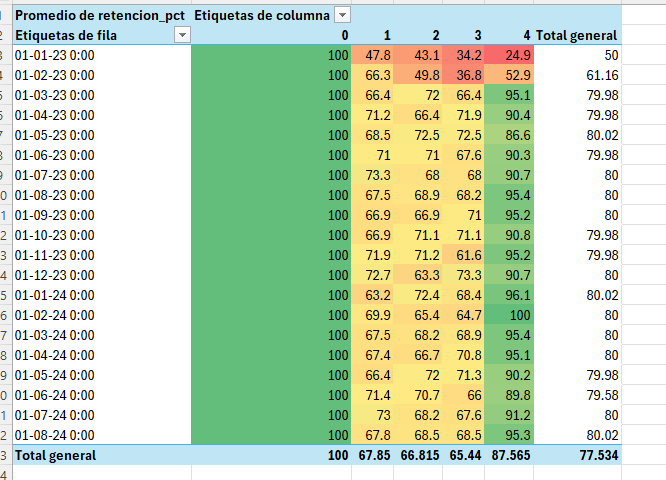
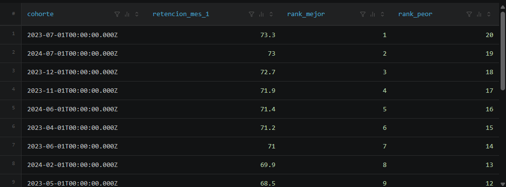

# 📊 Análisis de Cohortes y Retención de Clientes con DuckDB y SQL

Este proyecto realiza un análisis de cohortes y retención de usuarios para evaluar el ciclo de vida y comportamiento de recompra de clientes a lo largo del tiempo.

El análisis utiliza un motor OLAP de alto rendimiento (**DuckDB**) integrado localmente en **VS Code**, aprovechando técnicas avanzadas de SQL como Expresiones Comunes de Tabla (**CTEs**), Funciones de Ventana (**Window Functions**) y transformaciones de fechas.

---

## 🎯 Objetivos del Proyecto

1. **Identificar Cohortes:** Agrupar a los usuarios según el mes de su primera transacción.
2. **Medir Actividad Mensual:** Rastrear el comportamiento de compra de cada cohorte en los meses posteriores ($m_0, m_1, m_2, \dots$).
3. **Construir la Matriz de Retención:** Calcular el porcentaje de usuarios retenidos período a período.
4. **Análisis de Tendencias y Benchmarks:** Comparar la evolución de cada grupo contra la media general del negocio utilizando `LAG()` y `AVG() OVER()`.
5. **Generar Métricas Ejecutivas:** Determinar la retención promedio crítica al **Mes 1** y rankear las mejores/peores cohortes mediante `RANK()`.

---

### 🛠️ Automatización de Carga de Datos con DuckDB (`main.py`)

Para facilitar la ingesta y preparación de los datos sin depender de un servidor de base de datos externo, se incluye el script de Python `main.py`.

**¿Qué hace este script?**

* **Conexión local eficiente:** Crea y se conecta a una base de datos relacional local en disco llamada `cohortes.duckdb`.
* **Carga automatizada de archivos:** Recorre de forma dinámica la carpeta `/data` buscando todos los archivos `.csv`.
* **Detección automática de esquemas:** Utiliza la función `read_csv_auto()` de DuckDB para inferir automáticamente los tipos de datos (fechas, enteros, flotantes) e importar los datos sin necesidad de definir el esquema manualmente.
* **Creación de tablas:** Genera o reemplaza automáticamente cada tabla en la base de datos DuckDB usando el nombre de su archivo fuente.

#### Cómo ejecutar el script de carga

```bash
python main.py

## 🛠️ Tecnologías y Herramientas

* **Motor SQL:** [DuckDB](https://duckdb.org/) (Base de datos analítica local `.duckdb`).
* **Entorno de Desarrollo:** VS Code + DuckDB Extension.
* **Conceptos SQL Aplicados:**
  * `DATE_TRUNC`, `DATEDIFF` para manejo de fechas.
  * CTEs para la estructuración modular de la consulta.
  * Window Functions: `LAG()`, `AVG() OVER(PARTITION BY ...)`, `RANK() OVER(...)`.
  * Agregaciones con `COUNT(DISTINCT ...)`.

---

## 📊 Resultados y Visualizaciones

### 1. Matriz de Retención por Cohortes (Heatmap)



**Explicación del gráfico:**

* **Visualización general:** Muestra la evolución de la tasa de retención (%) para cada cohorte mensual desde el mes de adquisición ($m_0$) hasta cuatro meses posteriores ($m_4$).
* **Hallazgo principal:** La cohorte inicial de **Enero 2023** sufrió la peor caída de retención en el ciclo de vida del usuario, descendiendo hasta un **24.9%** en el Mes 4 (resaltado en rojo).
* **Estabilización de retención:** A partir de Febrero 2023, las estrategias de fidelización mostraron una mejora consistente, manteniendo la retención entre el **65% y el 95%** en los meses $m_1$ a $m_4$ (tonos verdes).
* **Línea base (Benchmark):** El promedio global de retención en el primer mes ($m_1$) se sitúa en un **67.85%**.

---

### 2. Ranking de Desempeño en el Mes 1 (`RANK() OVER`)



**Explicación de la consulta:**

* **Metodología:** Se utilizaron funciones de ventana en SQL (`RANK() OVER`) para evaluar y clasificar la retención del primer mes ($m_1$) de cada cohorte.
* **Mejores cohortes:** La cohorte de **Julio 2023** ocupa el primer puesto con un **73.3%** de retención en su primer mes, seguida muy de cerca por **Julio 2024** (**73.0%**) y **Diciembre 2023** (**72.7%**).
* **Patrón estacional:** Se observa un mayor rendimiento de retención inicial durante los períodos de mitad de año y cierre de año.

---

## 📁 Estructura del Repositorio

```text
├── .vscode/                        # Configuración de entorno en VS Code
├── data/                           # Archivos fuente de datos (CSV)
├── assets/                         # Capturas de las tablas
├── sql/
│   └── 01_analisis_cohortes.sql    # Script SQL completo con la lógica por pasos
├── venv/                           # Entorno virtual de Python
├── cohortes.duckdb                 # Base de datos analítica local en DuckDB
├── main.py                         # Script ejecutable de Python para conectar con DuckDB y ejecutar las consultas
├── requirements.txt                # Librerías y dependencias necesarias (duckdb, pandas, etc.)
└── README.md                       # Documentación y presentación del proyecto
